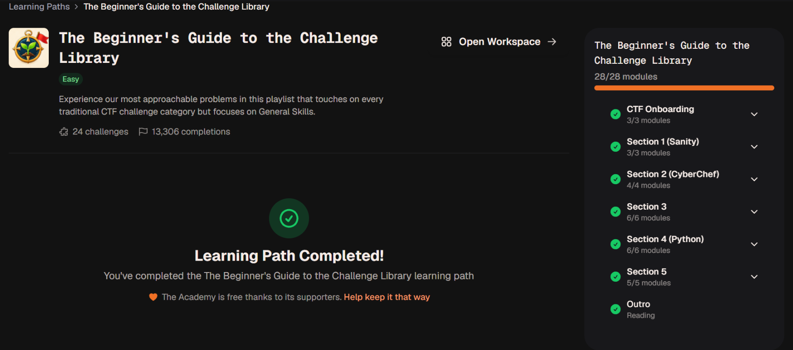

# Cybersecurity CTF Labs

A repository for documenting learning through CyLab Academy's [Beginner's Guide to the Challenge Library](https://learn.cylabacademy.org/learning-paths/18) and other capture-the-flag (CTF) platforms.

The goal is to explain the reasoning behind each exercise—not just record an answer.

*CyLab Academy learning path completion (28/28 modules).*

## Repository map

- [Learning roadmap](learning-roadmap.md) — topics and current progress.
- [Platforms](platforms.md) — platforms covered or planned.
- [CTF write-ups](ctf-writeups/README.md) — challenge notes organized by platform and category.
- [Fundamentals](fundamentals/README.md) — foundational technical notes.
- [Tools](tools/README.md) — notes on tools used during learning.
- [Scripts](scripts/README.md) — scripts developed for labs and exercises.
- [Write-up template](templates/challenge-writeup-template.md) — structure for new challenge notes.
- [Resources](resources/README.md) — references and further learning.

## Challenge write-ups

- [Arcane Calculator](ctf-writeups/cylab-academy/arcane-calculator.md)
- [Buffer Overflow 0](ctf-writeups/picoctf/binary-exploitation/buffer-overflow-0.md)

## Approach

Write-ups should distinguish observed results from expected behavior, explain commands and findings, and include references. Do not publish flags or claim completion unless the result has been verified.
